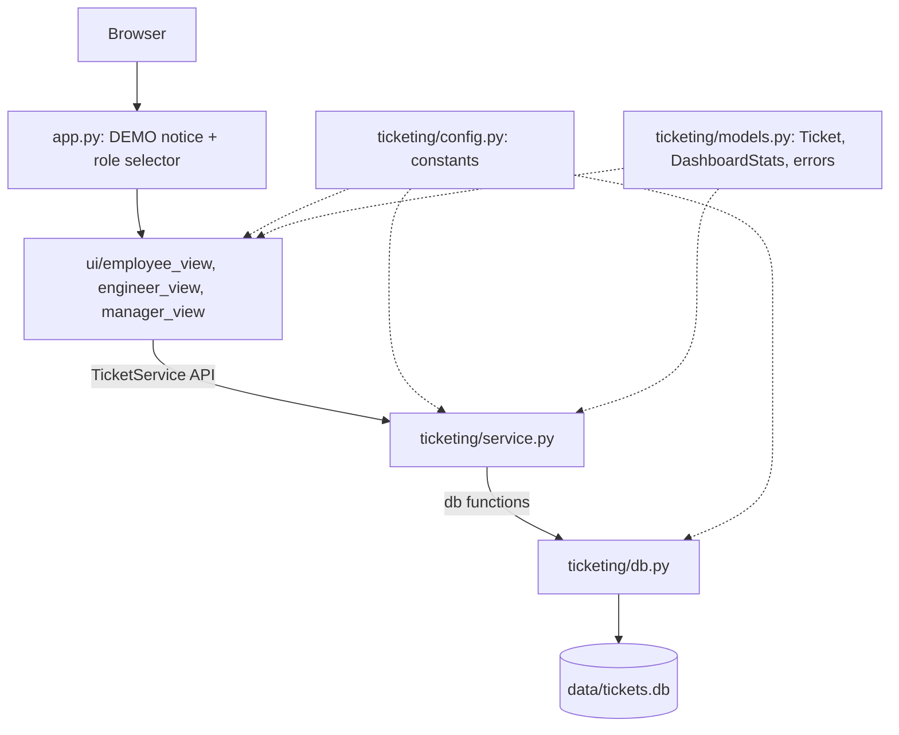

# Architecture - IT Support Ticket Management System

Status: DESIGN v1, awaiting human approval (CLAUDE.md checkpoint 3). Author: solution-architect, 2026-10-24.
Inputs: `docs/client-requirements.md`, `docs/requirements-analysis.md` (baseline v2), `docs/traceability-matrix.md`.
Companion documents: `docs/data-model.md` (DM), `docs/interface-contracts.md` (IC), `docs/validation-rules.md` (VR), `docs/ui-design.md` (UI), `docs/test-strategy.md` (TS), `docs/implementation-plan.md` (IP).

## 0. Demo-role disclosure (NFR-12, FR-21)

The Employee / Support Engineer / Manager selector is a DEMO switch. It is NOT authentication and NOT authorization. Anyone who opens the application can pick any role and use any screen. The service layer does not know about roles and never claims to check them. This design makes no security, privacy or access-control claim. Parameterized SQL and input validation are code-quality rules (NFR-08), not security guarantees.

## 1. Guiding principle: intentionally simple

Classroom demonstration (NFR-04). The design is five production Python modules, four UI modules and one entry file. No ORM, no framework beyond Streamlit, no async, no plugin system, no migrations, no caching layer, no authentication. Anything not traceable to an FR/NFR is excluded (see section 11).

## 2. Layers and data flow

```
 Browser (NFR-02)
    |
    v
 +-------------------------------------------------------------+
 | UI layer (Streamlit)         app.py, ui/*.py                |
 |  demo notice + role selector, forms, tables, dashboard      |
 |  NO SQL, NO sqlite3 import, NO business rules               |
 +--------------------------+----------------------------------+
                            | TicketService methods only (IC)
                            v
 +-------------------------------------------------------------+
 | Service layer (plain Python)  ticketing/service.py          |
 |  validation, trimming, status workflow, updated_at,         |
 |  dashboard zero-filling, error translation                  |
 +--------------------------+----------------------------------+
                            | db.* functions (IC section 8)
                            v
 +-------------------------------------------------------------+
 | Data layer (sqlite3)          ticketing/db.py               |
 |  all SQL (parameterized, static strings), transactions      |
 +--------------------------+----------------------------------+
                            v
                  data/tickets.db   (local file, NFR-01)
```



Import rules (enforced by a static test, TS section 6):

| Module | May import | Must not import |
|---|---|---|
| `app.py`, `ui/*` | `streamlit`, `ticketing.service`, `ticketing.models`, `ticketing.config`, stdlib | `sqlite3`, `ticketing.db`; no SQL text |
| `ticketing/service.py` | `ticketing.db`, `ticketing.config`, `ticketing.models`, stdlib | `streamlit`, `sqlite3` (except to catch `sqlite3.Error`) |
| `ticketing/db.py` | `sqlite3`, `ticketing.config` (only for the lists used in the DDL), stdlib | `streamlit`, `ticketing.service`, `ticketing.models` |
| `ticketing/models.py`, `ticketing/config.py` | stdlib only | everything else |

Typical flow (create ticket, FR-01): form submit -> `ui/employee_view` calls `service.create_ticket(...)` -> service trims and validates (raises `ValidationError` with no DB access on failure, NFR-06) -> `db.session(write=True)` -> `db.insert_ticket` -> service reads the row back and returns a `Ticket` -> UI shows confirmation with the ID (AC-01).

## 3. Run and launch approach

- From the repository root: `streamlit run app.py` (NFR-02, NFR-10). The entry file lives at the root so `ticketing` and `ui` import without path tricks.
- Local only (NFR-09, ASM-12): `.streamlit/config.toml` sets `server.address = "localhost"` and `browser.gatherUsageStats = false` (Streamlit otherwise sends anonymous usage statistics to an external service, which conflicts with NFR-09/AC-58). This file is a recommended small addition supporting NFR-09; flagged for approval (section 9).
- First run creates `data/` and the schema automatically (`TicketService.__init__` -> `db.init_schema`). No seed data (FR-20 requires an empty database to work).

## 4. Database file location and tests

- Default path: `<repo>/data/tickets.db`, computed in `ticketing/config.py` (`get_db_path()`).
- Override: environment variable `TICKET_DB_PATH` (absolute or relative path). Used for manual experiments and by AppTest UI tests.
- `data/` is git-ignored (NFR-09: no real data in the repository).
- The service always receives its path explicitly: `TicketService(db_path=...)`. Tests pass `tmp_path / "test.db"`; no test touches the default path (an autouse fixture also points `TICKET_DB_PATH` at a temp file as a guard, TS section 3). Supports NFR-07, AC-56.
- Connections are short-lived: opened per operation and closed at the end (`db.session`). This makes persistence across reconnects (AC-47, AC-48) true by construction and avoids Streamlit rerun and thread issues with `sqlite3` connection objects.

## 5. Dependency list (for a later `requirements.txt`; orchestrator owns it; ask the human before installing)

| Package | Purpose | Suggested spec |
|---|---|---|
| `streamlit` | UI (NFR-10). Brings pandas, used by charts and dataframes. Must be >= 1.28 for `streamlit.testing.v1.AppTest`; suggest `>=1.35,<2` and pin the exact installed version once the orchestrator checks it. | `streamlit>=1.35,<2` |
| `pytest` | tests (NFR-10) | `pytest>=7.4` (needs `pythonpath` ini option) |
| `ruff` | lint (NFR-11) | `ruff>=0.5` |

Standard library only otherwise (`sqlite3`, `dataclasses`, `datetime`, `logging`, `pathlib`, `contextlib`, `os`). Python 3.10+ (BL-01): `X | None` annotations are allowed.

## 6. Proposed directory layout and module responsibilities

```
ClaudeCode_INC_MGMT_System/
  app.py                       frontend-developer
  ui/
    __init__.py                frontend-developer
    common.py                  frontend-developer
    employee_view.py           frontend-developer
    engineer_view.py           frontend-developer
    manager_view.py            frontend-developer
  ticketing/
    __init__.py                backend-developer
    config.py                  backend-developer
    models.py                  backend-developer
    db.py                      backend-developer
    service.py                 backend-developer
  tests/                       qa-engineer (see TS)
  docs/                        architect / analyst / qa / security (docs only)
  data/                        runtime only, git-ignored
  .streamlit/config.toml       orchestrator
  ruff.toml  pytest.ini  requirements.txt  .gitignore  README.md   (owners in IP section 3)
```

| File | Responsibility (justification) |
|---|---|
| `app.py` | Streamlit entry point. Sets the page config, renders the always-visible DEMO notice (FR-21, AC-45), renders the role selector in the sidebar, builds one `TicketService`, and calls the `render(service)` function of the selected role's view (AC-44). Contains the role-to-view mapping (`ROLE_VIEWS`), which is the only place that decides what each role sees (ASM-18). No data logic. |
| `ui/common.py` | Small shared UI helpers used by more than one view: the DEMO notice text and renderer, the error renderer (`show_error(exc)`), a ticket-to-table-rows converter, the read-only ticket details renderer (FR-07; used by Employee and Engineer views), and the flash-message helper. Exists to avoid duplicating the details renderer and to keep literal-text rendering rules in one place. |
| `ui/employee_view.py` | `render(service)`. Two tabs: "Raise a ticket" (form, FR-01/02/03/25, AC-01..11, 51, 52, 67) and "My tickets" (name box, list, details, FR-06/07/26, AC-66). No update controls (AC-66). |
| `ui/engineer_view.py` | `render(service)`. Filters (FR-08), ticket table (FR-06), details (FR-07), and update panels for status, priority and resolution note (FR-09/10/11/15). Largest view. |
| `ui/manager_view.py` | `render(service)`. Dashboard: numeric metrics and charts for total, status, priority and category counts (FR-16/18/19/20/23/24). Dashboard only; no ticket list (ASM-18). |
| `ticketing/config.py` | The single place for every tunable rule and constant: status/priority/category lists, defaults, length limits, transition table, read-only statuses, "resolved needs note" flag, field labels, timestamp formats, DB path resolution. Every unapproved assumption lives here or in one named function (section 9). No logic beyond `get_db_path()`. |
| `ticketing/models.py` | Plain data shapes shared across layers: `Ticket` and `DashboardStats` dataclasses, the error classes (`TicketError`, `ValidationError`, `NotFoundError`, `TicketStateError`, `StorageError`), and `format_timestamp()`. Separate from `service.py` so that the UI can import types without importing the service internals and so that `db.py` stays independent. |
| `ticketing/db.py` | The only module containing SQL and `sqlite3` code: connect, session (transaction) context manager, schema creation, and a small set of single-purpose query functions returning plain `dict`s and ints. All statements are static strings with `?` parameters (NFR-08). Knows nothing about validation or workflow. |
| `ticketing/service.py` | `TicketService`: the only API the UI calls. Owns trimming, validation, status workflow, "closed is read-only", `updated_at` maintenance, atomic read-validate-write, dashboard zero-filling, and translation of `sqlite3.Error` into `StorageError` (FR-02, FR-09 to FR-11, FR-13, FR-15, FR-16 to FR-20, FR-23 to FR-26, NFR-06). |

Not created (and why): no `repositories/`, `schemas/`, `utils.py`, `logging_config.py` (logging is two lines in `app.py`), no `ui/pages/` multipage structure (a role dispatch in one entry file is simpler and keeps the DEMO notice and selector on every screen), no separate `ticket_service` per role (service has no role concept).

## 7. Cross-cutting concerns

| Concern | Decision | Traces to |
|---|---|---|
| Validation | Service layer only (VR). UI does not duplicate limits and does not set `max_chars`, so over-limit input reaches the service and produces the specified message. DB `CHECK` constraints are a last-line defence for enum values and non-empty text. | FR-02, AC-03..08, 67 |
| Error handling | Service raises typed exceptions (IC section 4). UI catches `TicketError` and shows `st.error`. Messages are fixed templates that never echo user-entered text, so they render safely. Unexpected `sqlite3.Error` becomes `StorageError` with a generic message after being logged. Rollback on any failure. | NFR-06, AC-55 |
| Atomicity | Every write runs in `BEGIN IMMEDIATE ... COMMIT` via `db.session(write=True)`; read-validate-write happens inside that single transaction. | NFR-06, FR-10 |
| Logging | Stdlib `logging`, logger name `ticketing`. Only the service logs, only at WARNING/ERROR for `StorageError`, with the ticket ID and exception class but never ticket text. Basic config (`logging.basicConfig(level=INFO)`) is in `app.py`. Supporting item, no explicit requirement (section 11). | NFR-06 (diagnosis of failed operations) |
| Configuration | Constants in `config.py`; only runtime setting is `TICKET_DB_PATH`. No config files parsed by the app. | NFR-07, NFR-09 |
| Parameterized queries | All values bound with `?`. No string-built SQL: filters use the static `(? IS NULL OR col = ?)` pattern, updates use `COALESCE(?, col)`, counts use one fixed statement per column. The DDL is built from `config` constants only (never from user input) because DDL cannot take parameters. Ruff rule `S608` is enabled as evidence. | NFR-08, AC-57 |
| Secrets | None exist. No credentials, tokens or API keys anywhere. No network access. | NFR-09, AC-58 |
| Time | `datetime.now()` local time via an injectable `clock` callable in `TicketService`, so tests can control `created_at`/`updated_at` without sleeping. | FR-04, FR-13, AC-33, ASM-15 |
| Safe rendering | User text is displayed with `st.text`, disabled `st.text_area` or `st.dataframe`, never with `st.markdown`/`st.write`/`unsafe_allow_html`, so special characters appear exactly as typed. | FR-02, AC-06, AC-36 |
| Testability | Service takes `db_path` and `clock`; UI takes the service as an argument to `render(service)`; env override for AppTest. | NFR-07, AC-56 |

## 8. Key decisions and trade-offs

| # | Decision | Alternative rejected | Trade-off |
|---|---|---|---|
| D1 | One class `TicketService` with per-operation connections | Module functions with a global connection; repository pattern | Slightly more `open/close` calls; zero shared-state bugs under Streamlit reruns and threads. |
| D2 | `db.py` returns `dict`/`int`, service builds `Ticket` | DB returns dataclasses | Two-step conversion, but `db.py` has no dependency on `models.py`, keeping the SQL layer replaceable and trivially testable. |
| D3 | Role-less service; roles are only a UI dispatch | Pass `role` into service and check it | Honest about BL-10: a check would imply authorization that does not exist (FR-21, NFR-12). |
| D4 | Rules in `config.py` constants (transition table, limits, lists) | Hard-coded in service | Each unapproved assumption can be changed in one place (section 9). |
| D5 | IDs are `INTEGER PRIMARY KEY AUTOINCREMENT` | UUIDs, prefixed strings | Simple, ordered (newest first = highest ID), never reused (FR-04, AC-09). |
| D6 | Timestamps stored as local-time `TEXT` `YYYY-MM-DD HH:MM:SS` | UTC, epoch integers | Human-readable in the DB file; sorts correctly as text; ASM-15 says local time. Clock changes can make `updated_at` go backwards; accepted for a demo. |
| D7 | Newest first = `ORDER BY id DESC` | `ORDER BY created_at DESC` | IDs are strictly increasing so it is exact and index-free; avoids ties from second-level timestamps (FR-06, AC-12). |
| D8 | Case-insensitive creator match through a registered `casefold` SQLite function, with the lookup key casefolded in Python | `COLLATE NOCASE` (ASCII only) | One extra line in `db.connect`; correct for non-ASCII names (AC-19, AC-66). |
| D9 | No index | Indexes on status/priority/creator | 1,000 rows (ASM-11) scan instantly; add only if AC-54 fails. |
| D10 | `TicketService()` created on every Streamlit rerun, no `st.cache_resource` | Cached singleton | Construction is cheap (`CREATE TABLE IF NOT EXISTS`); avoids stale-path bugs between AppTest runs. |
| D11 | No schema migration | Migration tool | If `config` lists or DDL change, delete `data/tickets.db` (classroom data). Documented risk R2. |
| D12 | Engineer ticket selection by `st.selectbox` of IDs, not row-click selection | `st.dataframe(on_select=...)` | Works on more Streamlit versions and in AppTest; slightly less slick. |

## 9. Design decisions depending on unapproved assumptions

Each is isolated so a rejection is cheap to apply. "Change cost" lists files touched. Defaults follow the suggested values in `docs/requirements-analysis.md` section 7.

| ASM | Design decision | Isolated in | Change cost |
|---|---|---|---|
| ASM-02 | Creator is a free-text name; no employee directory. | UI form field; service treats it as plain validated text | UI only if a dropdown is wanted |
| ASM-03 | Limits creator 100, title 100, description 2000, resolution note 1000. Error messages read the numbers from config. | `config.LIMITS` | One constant |
| ASM-04 / ASM-24 | Employee chooses priority at creation (default Medium); only the engineer path changes it later; same-value change rejected with `TicketStateError`. | `config.DEFAULT_PRIORITY` (UI default); one `if` in `service.change_priority` | One line each |
| ASM-06 | Transition table: Open->In Progress; In Progress->Open, Resolved; Resolved->In Progress, Closed; Closed->none. Same-status is rejected because it is not in the table. | `config.TRANSITIONS` | One constant |
| ASM-13 | Duplicates allowed: no uniqueness check, no UNIQUE constraint. | absence of code | Add one check in `create_ticket` |
| ASM-15 | Local time, stored `YYYY-MM-DD HH:MM:SS`, displayed `YYYY-MM-DD HH:MM`. | `config.STORE_TS_FORMAT`, `config.DISPLAY_TS_FORMAT`, `models.format_timestamp` | Constants |
| ASM-16 | Trim surrounding whitespace; whitespace-only is empty; everything else stored literally; only text that cannot be encoded as UTF-8 is rejected. | `service._clean_text` (one function) | One function |
| ASM-18 | Employee: raise + own tickets; Engineer: all tickets, filters, updates; Manager: dashboard only. | `app.ROLE_VIEWS` and the three view modules | UI only |
| ASM-19 | Categories Hardware, Software, Network, Account Access, Other; default Other; immutable after creation (no service method changes it). | `config.CATEGORIES`, `config.DEFAULT_CATEGORY`; DDL CHECK is generated from the same constant | One constant, plus delete the DB file because the CHECK is baked into the table (R2) |
| ASM-20 | Closed is read-only and final (`TRANSITIONS["Closed"]` empty, `READ_ONLY_STATUSES`). "Only engineers set Closed" is satisfied by where the control sits (Engineer view only); the service cannot enforce it because it has no role concept. | `config.READ_ONLY_STATUSES`, `config.TRANSITIONS` | Constants |
| ASM-21 | A non-empty resolution note is required to set Resolved; note retained on reopen. | `config.RESOLVED_REQUIRES_NOTE` | One flag |
| ASM-22 | No "pending" figure; `DashboardStats` carries the four status counts only. | `models.DashboardStats` | If wanted, UI sums Open + In Progress (no service change) |
| ASM-23 | "My tickets" lists tickets whose creator equals the typed name (trimmed, case-folded). | `service.list_my_tickets`, `db.select_tickets(creator_key=...)`, `ui/employee_view` | If employees should see all tickets, the UI calls `list_tickets()` instead; no service change |
| ASM-09 | No status history table, no audit table. | absence of schema | Adding history later is a new table plus service writes |

## 10. Risks and open questions

| ID | Risk / question | Mitigation or owner |
|---|---|---|
| R1 | Pending assumptions above may change. | Isolated in config; human decision at checkpoint 3. |
| R2 | Schema `CHECK` constraints bake in the config lists; changing lists on an existing DB file has no effect on the old table. | Documented: delete `data/tickets.db` after changing lists (no migration, D11). Orchestrator to mention in README. |
| R3 | Concurrent browser sessions writing: SQLite serializes writes; `BEGIN IMMEDIATE` plus a 5 second busy timeout. A lost race surfaces as `StorageError`. | Accepted (RISK-06, ASM-11). |
| R4 | `streamlit.testing` (AppTest) API may differ by Streamlit version; widget-level assertions can be brittle. | Smoke-level UI tests only; manual checklist for the rest (TS section 5). |
| R5 | Streamlit usage-statistics telemetry would contact an external service. | `.streamlit/config.toml` (section 3). Needs human approval as a small addition. |
| R6 | System clock moved backwards makes `updated_at` earlier than before. | Accepted; no DB check on timestamps. |
| R7 | Free-text creator names can differ by typos (RISK-04, RISK-12). | Documented limitation in README and UI caption. |
| Q1 | Who writes README.md and the user-facing demo disclosure (NFR-12, AC-68)? | Proposed: orchestrator, from the content spec in IP section 4. Needs human decision (architect and analyst may write `docs/` only). |
| Q2 | Approve `.streamlit/config.toml` (localhost, no telemetry) as a small addition? | Human. |
| Q3 | Approve Streamlit version floor (>= 1.35) after the orchestrator checks the installed version? | Orchestrator / human. |

## 11. Requirement coverage check

Every active requirement has at least one design element (details in `docs/traceability-matrix.md`, "Design element" column).

| Check | Result |
|---|---|
| Active FR with no design element | None. FR-01..11, 13, 15, 16, 18..21, 23..26 (22 active) are all mapped. |
| Active NFR with no design element | None. NFR-01..12 mapped. NFR-02, NFR-03, NFR-04, NFR-05, NFR-09 (partly), NFR-12 are satisfied by UI design, config files or documentation rather than by service code; their design element is the named document or file. |
| Active AC with no design element | None (65 active ACs). ACs that cannot be exercised through the UI by construction: AC-15 and AC-29 (the Engineer UI only offers IDs that exist), so they are verified at service level; the UI shows the same `NotFoundError` message if it ever occurs. |
| Design elements with no requirement | `ticketing/models.StorageError` and logging (supporting NFR-06 only indirectly; kept minimal, listed as supporting items); `service.allowed_next_statuses` (supports FR-09/FR-10 usability: avoids the UI duplicating the transition table; no AC of its own, covered by AC-21..27 UI flow); `clock` injection (testability for FR-13/AC-33, NFR-07); `.streamlit/config.toml` (recommended addition, NFR-09; needs approval). Nothing else. |
| Scope kept out | Authentication, history, assignee, attachments, search, pagination, delete, export, notifications, caching, migrations, ORM, multipage app, i18n. |
